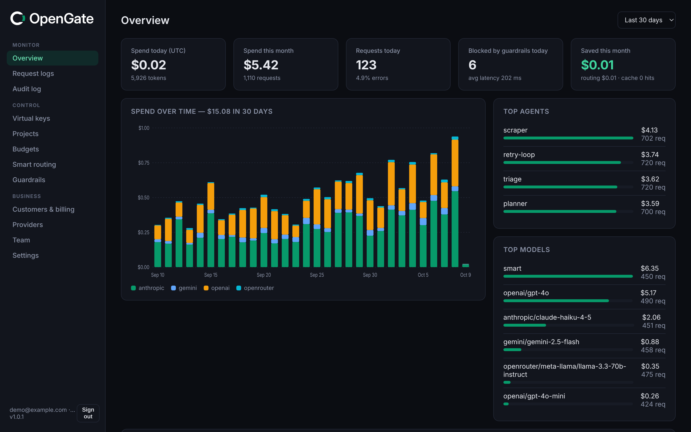

<p align="center">
  <picture>
    <source media="(prefers-color-scheme: dark)" srcset="assets/brand/opengate-logo-dark.svg">
    <source media="(prefers-color-scheme: light)" srcset="assets/brand/opengate-logo-light.svg">
    
  </picture>
</p>

# OpenGate

**The independent, self-hosted, open-source AI gateway, not owned by a payment company or a cloud vendor.**
One auditable static Go binary that sits between your agents and OpenAI, Anthropic, Google Gemini and OpenRouter,
so you get **hard spend limits with a kill switch**, **multi-provider failover**, and **request logs**, without a
sprawling Python supply chain.



**Docs:** [Getting started](docs/getting-started.md) · [Configuration](docs/configuration.md) · [Security model](docs/security-model.md) ·
[Admin API / OpenAPI](docs/admin-api.md) · [From LiteLLM](docs/migrate-from-litellm.md) · [From Helicone](docs/migrate-from-helicone.md) · [Changelog](CHANGELOG.md)

## Why OpenGate

Teams running fleets of AI agents keep hitting the same problems:

* **Runaway spend.** A looping agent or a leaked key can burn a month's budget overnight. Dashboards
  that only *report* spend don't help at 3 a.m.
* **Supply-chain risk.** An LLM gateway holds every provider credential you own. In March 2026 a
  compromised release of a popular Python gateway's PyPI package showed how exposed a large
  dependency tree leaves you.
* **Consolidation.** Independent gateway options are consolidating. For example, Stripe announced on
  Aug 19, 2026 that it has [agreed to acquire OpenRouter](https://stripe.com/newsroom/news/stripe-agrees-to-acquire-openrouter). The layer that holds your keys,
  sees your prompts and decides where your tokens go shouldn't belong to your payment processor, your cloud
  vendor or your model vendor.

OpenGate's answer:

| | |
|---|---|
| **Auditable single binary** | About 17 MB, statically linked, `CGO_ENABLED=0`. Four direct dependencies (pure-Go SQLite, pgx, YAML, `x/crypto`). The dashboard is vanilla JS embedded with `go:embed`, with no npm. |
| **Hard budgets and kill switch** | Daily, monthly and total USD limits plus requests-per-minute, per **key**, **agent** or **project**. Over-limit requests are rejected *before* they reach the provider. One click (or one API call) kills a key or project and **aborts its in-flight streams**. |
| **Failover and retries** | An ordered fallback list per model alias. Retries on 429, 5xx and timeouts with exponential backoff and jitter, honouring `Retry-After`. A stream fails over if the provider breaks before the first token. |
| **OpenAI-compatible** | `POST /v1/chat/completions` (streaming SSE and non-streaming), `/v1/embeddings`, `/v1/responses` and `GET /v1/models`. Point any OpenAI SDK at it. Anthropic and Gemini are translated both ways, including tools and streaming. |
| **Smart routing** | Rules by prompt length, tags, headers, agent or cost ceiling, plus an `auto` alias that picks the cheapest model meeting the request's difficulty tier. The dashboard shows the savings. |
| **Guardrails** | PII and secret redaction or blocking (emails, phones, Luhn-checked cards, IBAN, SSN/SIN, API keys, private keys) on requests and responses, and prompt-injection flags, per project. |
| **Customer billing** | Per-end-customer usage and cost, markup rules, monthly CSV export and Stripe Billing Meter sync, so AI-app founders can bill their users. |
| **Teams** | Organizations, argon2id accounts, owner/admin/member/viewer roles, invites and an audit log. Postgres for HA, Prometheus metrics, response cache. |
| **Secure by default** | Provider keys are AES-256-GCM encrypted at rest. Virtual keys are stored only as SHA-256 hashes. Body logging is **off** unless a project opts in. The server refuses to start without an admin token and master key, and binds to localhost by default. |
| **Independent** | Apache-2.0, self-hosted, with no phone-home and no telemetry. Not owned by a payment company, cloud or model vendor. Your traffic, keys and data stay on your infrastructure. |

## 2-minute quickstart

### Option A: try it with the bundled mock provider (no API keys)

```bash
git clone https://github.com/saief1/opengate && cd opengate
make demo          # builds, starts a mock upstream + OpenGate, seeds demo traffic
# open http://127.0.0.1:8080/ui/  (admin token: demo-admin-token-change-me)
```

### Option B: real providers

```bash
make build
eval "$(./bin/opengate keygen | sed 's/^/export /')"   # OPENGATE_MASTER_KEY + OPENGATE_ADMIN_TOKEN
export OPENAI_API_KEY=sk-...  ANTHROPIC_API_KEY=sk-ant-...      # or add them encrypted in the dashboard
./bin/opengate serve -config examples/opengate.example.yaml &

# Create a virtual key for an agent, with a $5/day hard cap
curl -s localhost:8080/admin/api/keys -H "Authorization: Bearer $OPENGATE_ADMIN_TOKEN" \
  -d '{"name":"research-bot","agent":"planner","limits":{"daily_usd":5,"rpm":60}}'
# -> {"key":"og-…", ...}   (shown once; only the hash is stored)
```

### Option C: Docker

```bash
cp examples/env.example .env
docker run --rm $(docker build -q .) keygen >> .env
docker compose up -d          # http://localhost:8080/ui/
```

The image is `distroless/static:nonroot`, runs read-only with all capabilities dropped, and keeps data in a `/data` volume.

## Using it

### curl

```bash
curl localhost:8080/v1/chat/completions \
  -H "Authorization: Bearer og-…" -H "Content-Type: application/json" \
  -d '{"model":"anthropic/claude-sonnet-4-5","messages":[{"role":"user","content":"Hello!"}]}'

# Streaming, via a failover alias
curl -N localhost:8080/v1/chat/completions -H "Authorization: Bearer og-…" \
  -d '{"model":"smart","stream":true,"messages":[{"role":"user","content":"Hi"}]}'
```

Every response carries `X-OpenGate-Request-Id`, `X-OpenGate-Provider`, `X-OpenGate-Model` and
`X-OpenGate-Attempts`. Non-streaming responses also carry `X-OpenGate-Cost-USD`.

### OpenAI SDK (Python)

```python
from openai import OpenAI
client = OpenAI(base_url="http://localhost:8080/v1", api_key="og-…")

r = client.chat.completions.create(model="openai/gpt-4o-mini",
                                   messages=[{"role": "user", "content": "Hello"}])
for chunk in client.chat.completions.create(model="gemini/gemini-2.5-flash", stream=True,
                                            messages=[{"role": "user", "content": "Stream!"}]):
    print(chunk.choices[0].delta.content or "", end="")
```

### OpenAI SDK (TypeScript)

```ts
import OpenAI from "openai";
const client = new OpenAI({ baseURL: "http://localhost:8080/v1", apiKey: "og-…" });
const r = await client.chat.completions.create({ model: "smart", messages: [{ role: "user", content: "Hi" }] });
```

### Model names

* `provider/model`: `openai/gpt-4.1`, `anthropic/claude-sonnet-4-5`, `gemini/gemini-2.5-pro`,
  `openrouter/meta-llama/llama-3.3-70b-instruct`, or any provider you define.
* Aliases: names you define under `routes:`, each mapping to an ordered failover list.

### Errors

All errors use the OpenAI format `{"error":{"message","type","param","code"}}`, so SDKs raise their usual exceptions:

| Situation | HTTP | `code` |
|---|---|---|
| Missing or invalid virtual key | 401 | `missing_api_key` / `invalid_api_key` |
| Key or project killed | 403 | `key_killed` / `project_killed` (`killed` if aborted in flight) |
| Spend limit reached | 429 (`Retry-After` = time until the period resets) | `budget_exceeded` (type `insufficient_quota`) |
| RPM limit reached | 429 + `Retry-After` | `rate_limit_exceeded` |
| Unknown model or provider | 404 | `model_not_found` |
| All upstream attempts failed | 502 (or the upstream 4xx) | `upstream_error` |

If a stream breaks mid-way, a final `data: {"error":…}` event is sent instead of `[DONE]`.

## Budgets, kill switch and alerts

* **Scopes:** `key` (one virtual key), `agent` (an agent label within a project, shared by all keys with
  that label) and `project`. A request must pass every scope that applies to it.
* **Periods:** `daily_usd` (resets 00:00 UTC), `monthly_usd` (resets on the 1st, UTC), `total_usd` (lifetime) and `rpm`.
  `0` means unlimited.
* **Cost:** prompt and completion tokens come from the provider's `usage` fields. For streams, OpenGate adds
  `stream_options.include_usage` upstream automatically and strips the extra chunk again unless you
  asked for it. Tokens × the price table (`opengate pricing`, editable YAML, hot-reloaded on `SIGHUP`
  or `POST /admin/api/pricing/reload`) gives the cost. Unknown models are charged at the `default` rate so budgets still apply.
  If a provider reports no usage (for example, an aborted stream), tokens are estimated (~4 chars/token) and the log is flagged as estimated.
* **Kill switch:** `POST /admin/api/keys/{id}/kill` or `/admin/api/projects/{id}/kill` (or the red button in the dashboard).
  New requests get a 403, and in-flight requests and streams for that key or project are cancelled immediately
  on the receiving instance, and within ~2 s on other replicas sharing the database (each replica polls the kill flags of its in-flight requests).
* **Worst-case reservations:** before a request goes upstream, its worst-case cost (prompt estimate + `max_tokens` × `n`) is reserved
  atomically against every limit and reconciled with actual usage afterwards. `max_tokens` and `max_completion_tokens` are
  collapsed into one field holding the larger value, so a cap can't be dodged by sending both. Passthrough features whose cost
  OpenGate can't see or bound (Responses `background`, provider-hosted tools such as web/file search, code interpreter and image
  generation, chat `n > 1`, `store: true`) are refused unless the project lists them in `allowed_features`.
* **Multiple replicas:** reservations live in each process; committed spend is shared through the database and re-read every
  `budgets.sync_interval` (5 s on PostgreSQL). With N replicas a limit can be overshot by up to N × in-flight × request cost
  inside one interval. **Run a single instance if limits must be exact to the cent**; DB-backed reservations are on the roadmap.
* **Alerts:** set `OPENGATE_ALERT_WEBHOOK_URL` to a Slack incoming webhook (or any HTTP endpoint). Alerts fire once
  per scope, period and threshold (default 80% and 100%), and on every kill-switch change. The payload is `{"text": "...", "kind", "scope", "period", "threshold", "spent_usd", "limit_usd", ...}`.

```bash
# Agent-wide budget: every key labelled "planner" in project prj_… shares $20/day
curl -X PUT localhost:8080/admin/api/limits -H "Authorization: Bearer $OPENGATE_ADMIN_TOKEN" \
  -d '{"scope":"agent","scope_id":"prj_…/planner","daily_usd":20}'
```

## Configuration reference

YAML file (`-config` or `OPENGATE_CONFIG`). Every field is optional, unknown fields are rejected, and `${VAR}` is expanded.
See [`examples/opengate.example.yaml`](examples/opengate.example.yaml).

| Key | Default | Env override | Notes |
|---|---|---|---|
| `listen` | `127.0.0.1:8080` | `OPENGATE_LISTEN` | The Docker image sets `0.0.0.0:8080` |
| `database` | `opengate.db` | `OPENGATE_DATABASE` | SQLite file (WAL mode) |
| `pricing_file` | built-in | `OPENGATE_PRICING_FILE` | Dump the built-in table with `opengate pricing > pricing.yaml` |
| `max_request_bytes` | 10 MiB | | |
| `body_log_max_bytes` | 64 KiB | | Per body, only for projects with body logging on |
| `default_max_tokens` | 4096 | | Sent to Anthropic when the client omits `max_tokens` |
| `disable_dashboard` | `false` | | |
| `providers.<name>` | openai, anthropic, gemini, openrouter | `OPENGATE_PROVIDER_<NAME>_BASE_URL` | `type` (`openai`\|`anthropic`\|`gemini`\|`openrouter`), `base_url`, `api_key_env`, `headers`, `timeout` (time to first byte and max gap between chunks, default 120s) |
| `routes.<alias>` | | | Ordered list of `provider/model` targets |
| `retry.max_attempts` | 2 | | Attempts per target before failing over |
| `retry.initial_backoff` / `max_backoff` | 250ms / 4s | | Exponential with ±20% jitter; a `Retry-After` above `max_backoff` fails over immediately |
| `alerts.webhook_url` | | `OPENGATE_ALERT_WEBHOOK_URL` | Slack-compatible |
| `alerts.thresholds` | `[0.8, 1.0]` | | |

Secrets come **only** from the environment: `OPENGATE_ADMIN_TOKEN` (16+ characters) and `OPENGATE_MASTER_KEY` (32 bytes, base64 or hex).
Provider keys are resolved in this order: the newest key stored through the dashboard or admin API (encrypted), then the provider's `api_key_env` variable.
Any OpenAI-compatible server (vLLM, Ollama, LM Studio, Together, Groq, …) works as `type: openai`.

### CLI

```
opengate serve [-config f]          run the gateway (default command)
opengate keygen                     generate OPENGATE_MASTER_KEY and OPENGATE_ADMIN_TOKEN
opengate create-key -name N [-project P] [-agent A] [-user U]
opengate pricing                    print the built-in price table
opengate mock-provider [-listen]    fake OpenAI/Anthropic/Gemini upstream for dev/demo
opengate demo-seed [-days 30]       synthetic historical logs (demo only)
opengate healthcheck | version
```

### Admin API

Every endpoint needs `Authorization: Bearer $OPENGATE_ADMIN_TOKEN`.

| Method & path | Purpose |
|---|---|
| `GET /admin/api/overview?days=30` | Totals, daily spend series by provider, top agents, models and projects |
| `GET /admin/api/logs?project_id&key_id&agent&model&errors=1&limit&offset` · `GET /admin/api/logs/{id}` | Request logs (bodies only on the detail endpoint, and only if logged) |
| `GET/POST /admin/api/projects` · `PATCH /admin/api/projects/{id}` `{"log_bodies":true}` | Projects |
| `POST /admin/api/projects/{id}/kill` · `/unkill` | Project kill switch |
| `GET/POST /admin/api/keys` · `DELETE /admin/api/keys/{id}` | Virtual keys (create accepts `limits`). DELETE revokes the key |
| `POST /admin/api/keys/{id}/kill` · `/unkill` | Key kill switch |
| `GET/PUT/DELETE /admin/api/limits` | Budgets and RPM per scope (DELETE takes `?scope=&scope_id=`) |
| `GET/POST /admin/api/provider-keys` · `DELETE /admin/api/provider-keys/{id}` | BYO provider keys, encrypted at rest. They are never returned |
| `GET /admin/api/providers` · `GET /admin/api/pricing` · `POST /admin/api/pricing/reload` | Introspection |

## Security model

* **Virtual keys** (`og-` + 192 random bits) are shown once and stored as SHA-256 hashes. A fast hash fits
  high-entropy random keys and keeps per-request authentication cheap.
* **Provider keys** are encrypted with AES-256-GCM under `OPENGATE_MASTER_KEY`, with a random nonce per value
  and the row id plus provider bound in as additional authenticated data, so ciphertexts cannot be swapped between rows. They are never
  returned by the API (only a `…1234` hint). Losing the master key means re-entering provider keys.
* **The admin token** is compared in constant time. The dashboard keeps it in `sessionStorage` only and sends it
  as a bearer header. Dashboard user sessions use `HttpOnly`, `SameSite=Strict` cookies plus a required `X-Requested-With`
  header on writes. Every admin route is scoped to the caller's organization (another org's IDs answer 404).
* **Brute-force protection:** wrong admin tokens are locked out per client IP, passwords per account+IP (plus a looser per-IP
  limit against spraying). The correct credential always works, so an attacker can't lock the operator out. The lockout table
  is bounded and expires. `X-Forwarded-For` is only used with `trust_proxy_headers`, read from the right, and with
  `trusted_proxies` only from those peers.
* **Customer attribution** (`X-OpenGate-Customer` / `user`) is client-asserted, so it's ignored unless the project sets
  `trust_customer_header` (use that only when the caller is your own backend). Alternatively, bind a key to a customer
  (`PATCH /admin/api/keys/{id} {"customer_id": "..."}`), which overrides and rejects conflicting assertions. Cache entries are
  scoped per project, key and customer.
* **Outbound URLs** (providers, Stripe, alert webhook) must be `https://` except loopback, unless `allow_insecure_upstream`.
* **Metrics** need their own `OPENGATE_METRICS_TOKEN` (or `metrics.public: true`). The admin token is deliberately not accepted.
* **The dashboard** is served with a strict CSP (`default-src 'self'`, no inline scripts or styles), `X-Frame-Options: DENY`
  and `nosniff`. All DOM is built with `textContent`, never `innerHTML`, so logged content can't inject markup.
* **Privacy:** prompt and response bodies are **not stored** unless a project turns on body logging (and then they're truncated).
  Metadata (model, tokens, cost, latency, status, key and agent) is always logged.
* **Network:** the gateway binds to localhost by default. For remote access, terminate TLS in a reverse proxy.
* **Supply chain:** four direct dependencies, all pure Go, pinned in `go.sum`, and builds use `-trimpath`. Read `go.mod`
  and audit it in an afternoon.

See [SECURITY.md](SECURITY.md) for reporting vulnerabilities.

## Architecture

```
cmd/opengate/          CLI entrypoint (serve, keygen, create-key, mock-provider, demo-seed…)
internal/config/       YAML + env loading, provider defaults, validation
internal/secure/       virtual keys, AES-GCM cipher, argon2id passwords, random tokens
internal/store/        SQLite / PostgreSQL storage + migrations: orgs, users, projects, keys, limits, logs, rules, customers, cache, audit
internal/pricing/      price table (embedded, source-cited default + editable YAML), cost calculation incl. cache tokens
internal/budget/       atomic reservations, spend limits, shared token-bucket RPM limiter, threshold webhooks
internal/provider/     adapters: OpenAI(-compatible), OpenRouter, Anthropic, Gemini (+ SSE, embeddings, Responses)
internal/routing/      routing rules + auto-tier classifier
internal/guard/        PII / secret detectors and prompt-injection heuristics
internal/billing/      markups, CSV export, Stripe meter-event sync
internal/metrics/      dependency-free Prometheus exporter
internal/server/       /v1 API, failover loop, kill switch, auth/RBAC, admin API, dashboard serving
internal/mockprovider/ fake upstream used by tests and the demo
web/static/            dashboard (vanilla JS/CSS, favicons, brand lockup; embedded)
site/                  static marketing landing page
docs/                  guides, OpenAPI spec, screenshots
examples/              configs, Go + TypeScript admin clients
assets/                brand SVGs for README, GitHub avatar + social preview
integration/           end-to-end tests against the mock provider (incl. security regressions)
```

## Development

```bash
make test          # unit + integration tests (no network or keys needed)
make vet           # go vet + gofmt check
make demo          # local demo with seeded traffic
```

## Roadmap

Shipped in 1.0: smart routing, PII and secret guardrails, customer billing with Stripe sync, Postgres, Prometheus,
RBAC and orgs, embeddings and Responses, atomic budget reservations, model allow-lists. Next:

* **Distillation:** capture opted-in traffic as datasets to fine-tune smaller, cheaper models that replace expensive ones on your own workloads.
* **Learned routing:** quality tiers informed by your own evals and feedback, plus budget-aware downgrades instead of a hard stop.
* **DB-backed budget reservations** for exact limits across many replicas.
* **SSO (OIDC/SAML), 2FA, master-key rotation, and OpenTelemetry traces.**
* **OpenGate Cloud:** a hosted version for teams (see `site/`; pricing is a draft).

## License

Apache-2.0. See [LICENSE](LICENSE).
